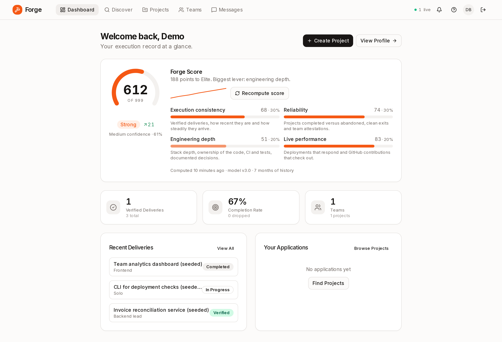
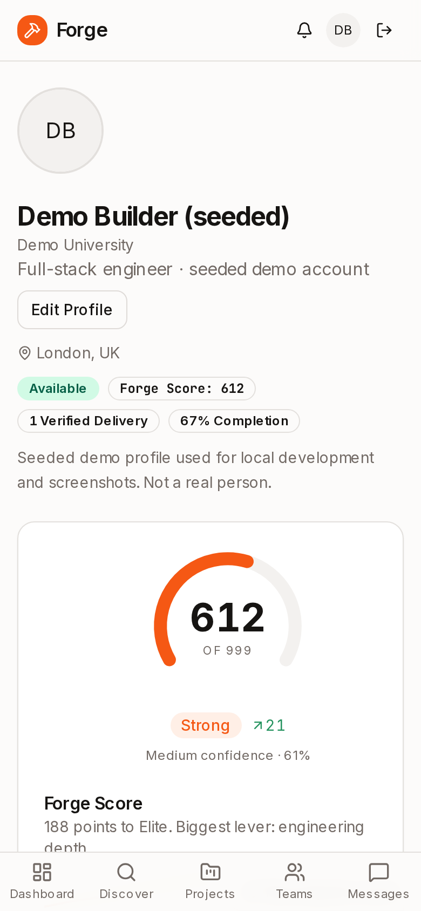
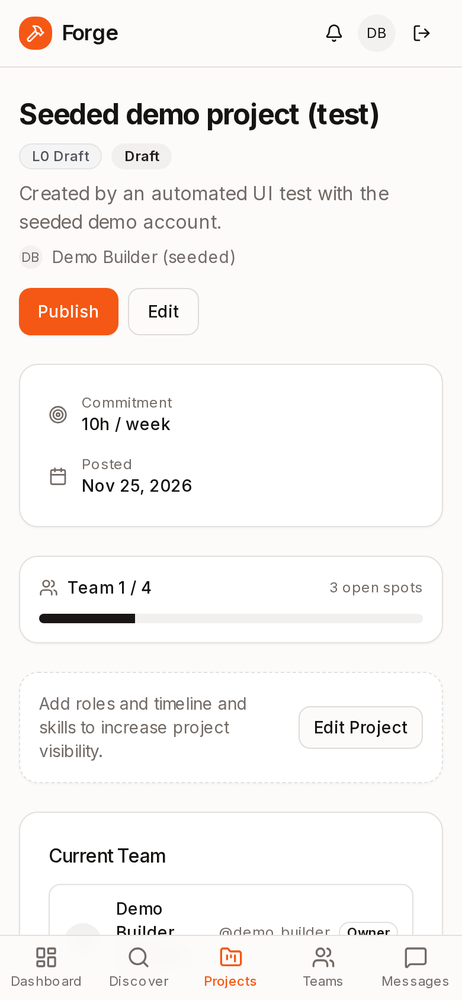
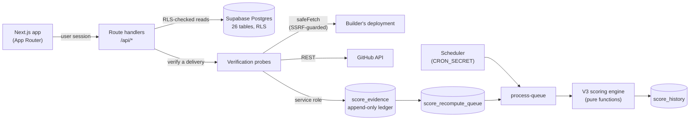

# Forge

[](https://github.com/ahyanadatia/Forge/actions/workflows/ci.yml)

A track record for builders, computed from evidence instead of self-description.

Builders log what they shipped. Forge checks each delivery against the live deployment and the
GitHub repository, records what it finds as evidence, and turns that evidence into a score teams
can use to find collaborators who deliver.

Next.js 16 · React 19 · TypeScript · Supabase (Postgres, Auth, row level security) · Claude (skill analysis) · Vitest

| Dashboard | Profile (mobile) | Project (mobile) |
| --- | --- | --- |
|  |  |  |

Screenshots are from a local build against the real schema, signed in as a seeded demo account
(`supabase/seed.sql`); every name and number in them is demo data.

## Architecture



Two rules shape the design:

- **Evidence is append-only and written by the system.** Users can read the ledger but cannot
  write to it; row level security has no insert policy. Routes authenticate the caller with their
  own session, check ownership, and only then write with a server-only service-role client.
- **Scoring is pure.** The engine in `src/lib/scoring/engine.ts` takes evidence and returns a
  score with no I/O, which is what makes it property-testable.

## How the score works

1. **Evidence.** Verified deliveries, probe results, team attestations and project outcomes, one
   row each in `score_evidence`, deduplicated by a hash of their content.
2. **Four dimensions**, 0–100 each, weighted by the active row in `scoring_model_versions` so the
   model can be re-versioned without a deploy: execution consistency (30%), reliability and
   commitment (30%), AI-orchestration (20%), live performance (20%).
3. **Anti-gaming multiplier** (0.6–1.05): bursty activity is scored with a Gini coefficient over
   weekly buckets, and reciprocal attestation rings and cloned templates are detected separately.
4. **Mapping** onto 100–999 through a sigmoid, with guard rails: decay after 60 days without new
   evidence, 800+ needs 4 months of history and 900+ needs 9, and one recompute moves the score by
   at most ±35 (±70 with milestone evidence).

## Verification probes and SSRF

A delivery's deployment URL is typed in by a user and fetched by the server, which is the classic
server-side request forgery setup. All such requests go through `src/lib/net/safe-fetch.ts`:

- only `http`/`https` on ports 80 and 443, and no credentials in the URL;
- IP literals are checked against private, loopback, link-local (including the cloud metadata
  address), CGNAT, multicast and reserved ranges, for IPv4 and IPv6, including IPv4-mapped forms;
- hostnames are resolved inside the socket's own DNS lookup hook, so the address that is checked
  is the address that is connected to (no DNS-rebinding gap between check and connect);
- redirects are followed by hand, and every hop is validated again (at most 3);
- a total timeout and a 512 KB cap on the body.

GitHub repository URLs are parsed strictly (`https://github.com/<owner>/<repo>` with valid
names) before they become API paths.

## Status

- The V3 score is what the app shows. The profile and dashboard read the latest `score_history`
  row, show the four dimensions with their model weights, a trend line and what is holding the
  score back. Other people's profiles use `get_public_score_v3()`, which returns the score and
  dimensions but not the integrity flags. "Recompute" queues a job and processes it straight
  away, so it doesn't wait for the cron.
- V2 (`src/lib/forge-score.ts`) is still in the repo for the band and confidence helpers and the
  old `/api/scoring/compute` route; it is no longer displayed.
- `src/types/database.ts` is hand-written and does not describe every table yet; queries against
  undescribed tables go through an explicit `untyped()` helper.

### Database fixes in this round

Found while running the app end to end against the real schema:

- `team_members` had a select policy that queried `team_members`, so every read of teams,
  members, tasks and activity failed with "infinite recursion detected in policy". Project
  pages showed an empty team. The membership checks now live in two `security definer` helpers.
- `accept_invite`, `decline_invite`, `accept_application` and `join_project_as_owner` trusted a
  user id passed in as an argument and could be called directly over the REST API. They now
  check it against `auth.uid()`.
- `scoring_model_versions` and `score_rate_limits` had RLS turned off.
- New projects failed to insert because `projects.timeline` was `NOT NULL` with no default and
  the create form doesn't ask for it.
- `/auth/callback?redirect=` was an open redirect (`?redirect=@evil.com`). It now only accepts
  same-origin paths.

## Installing it on a phone

Forge is a responsive web app with a manifest, icons and a small service worker (offline page,
cached static assets; API calls are never cached), so it can be added to the home screen from
Safari or Chrome. There is no native app-store build.

## Run it locally

Requires Node 22.12+.

```bash
git clone https://github.com/ahyanadatia/Forge.git
cd Forge
npm install
cp .env.local.example .env.local   # fill in the values
npm run dev                        # http://localhost:3000
```

1. Create a Supabase project and run the files in `supabase/migrations/` in filename order.
2. Enable GitHub under Authentication → Providers.
3. Fill in `.env.local`. `NEXT_PUBLIC_SUPABASE_URL` and `NEXT_PUBLIC_SUPABASE_ANON_KEY` are
   required; `SUPABASE_SERVICE_ROLE_KEY` is needed for V3 scoring (without it, Recompute shows
   a clear "not configured" message); `GITHUB_TOKEN`, `ANTHROPIC_API_KEY` and `CRON_SECRET` are
   optional (see the example file). Without an Anthropic key, skill analysis uses a
   deterministic fallback based on evidence counts.
4. Optional demo data: `psql "$DATABASE_URL" -v demo_password="'pick-one'" -f supabase/seed.sql`
   creates a labelled demo account (`demo@forge.local`) with deliveries and score history.
   `supabase/seed-cleanup.sql` removes it. Email sign-in has to be enabled for the demo account;
   real users sign in with GitHub.

## Checks

```bash
npm test            # Vitest, including property-based tests (fast-check)
npm run typecheck   # tsc --noEmit
npm run lint        # ESLint
npm run build
```

CI runs all four on every push and pull request.

## Layout

```
src/
├── app/                 # pages and route handlers (api/)
├── components/          # UI by feature; shadcn/ui primitives in ui/
├── lib/
│   ├── net/             # safeFetch
│   ├── scoring/         # V3 engine, anti-gaming, probes, evidence ledger, queue
│   ├── matching/        # builder-project compatibility, acceptance likelihood
│   ├── supabase/        # browser, server and service-role clients
│   └── __tests__/
├── services/            # database access
└── types/
supabase/migrations/     # schema, RLS policies, Postgres functions
```

## Contributors

Ahyan Adatia and Likhith Bakkachenna.
